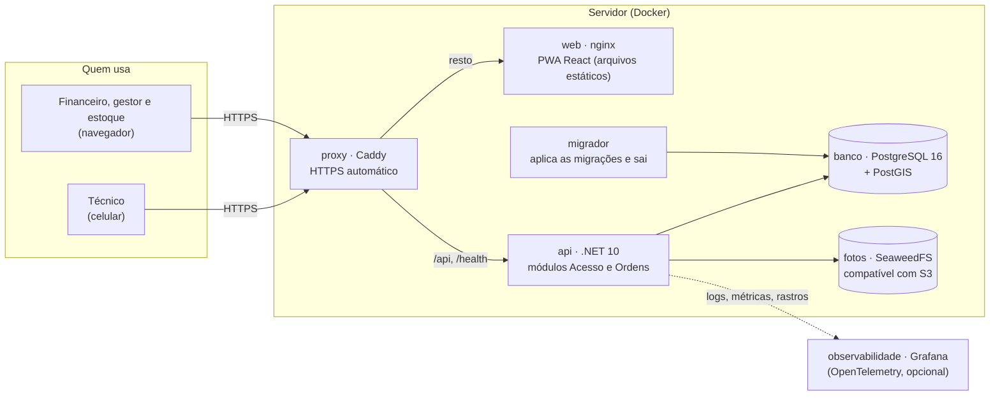
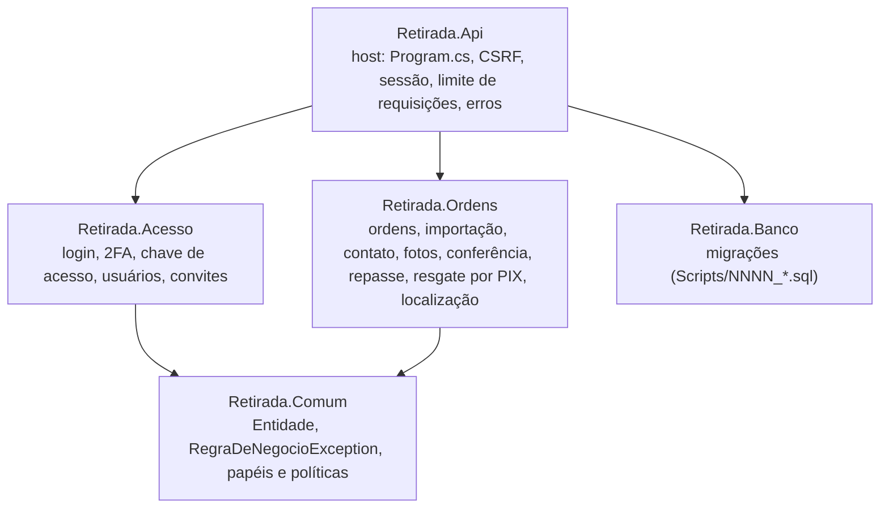
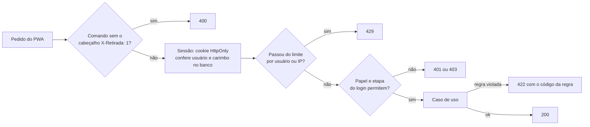
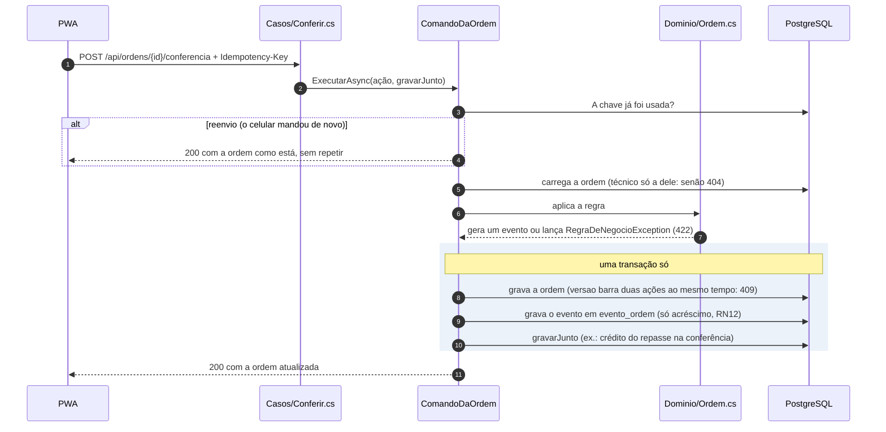
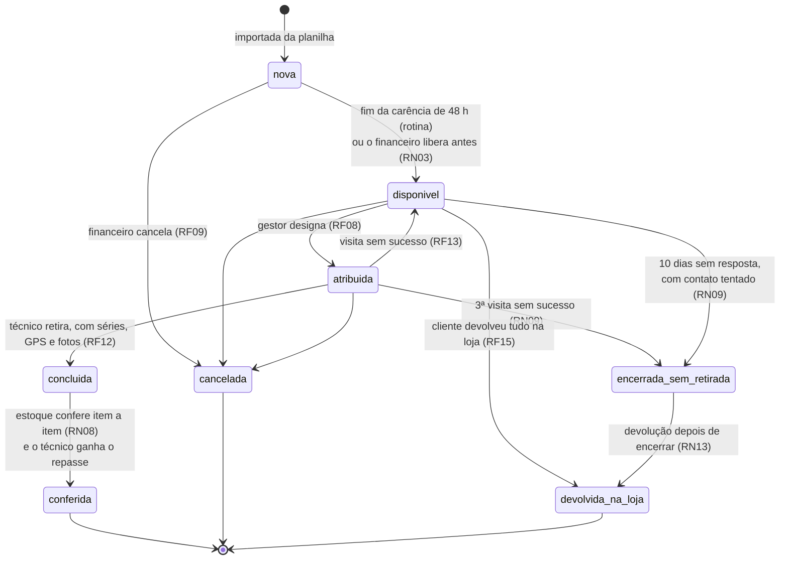
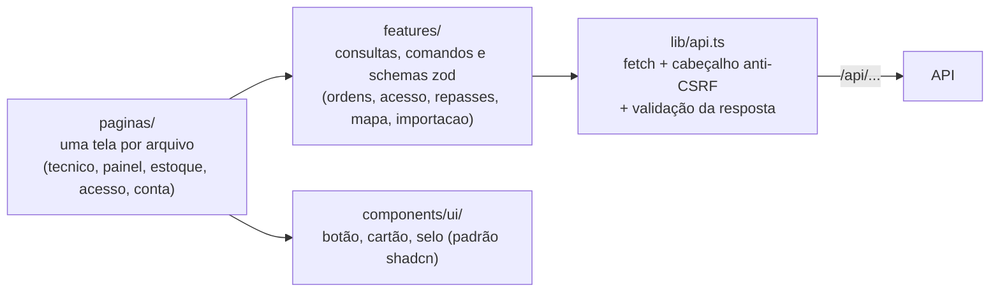
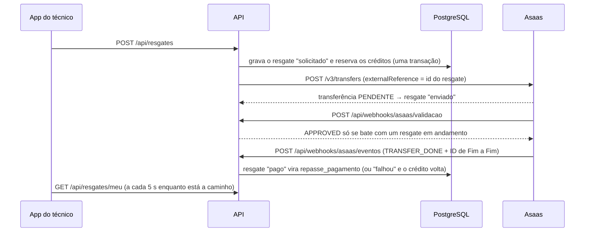

# Arquitetura

Como as partes do sistema se ligam, o caminho de um pedido e o ciclo de vida da ordem. O **porquê** de cada escolha está nas [ADRs](adr/README.md); aqui está o **como**.

## Visão geral

Um servidor só, com tudo em contêineres. Da internet, só o Caddy é alcançável (portas 80 e 443). O banco e as fotos ficam na rede interna do Docker.

- **Homologação local:** não tem o Caddy. O `web` (nginx) atende em `:8080` e repassa `/api` para a API.
- **Produção:** usa as imagens prontas do GHCR, publicadas pelo workflow "Publicar imagens" ([implantacao.md](implantacao.md)).

## Backend: monólito modular

Um processo só, com módulos separados (ADR-002 e ADR-003). O host não conhece as regras: só chama `AddModuloX` e `MapModuloX`.

Os testes de arquitetura (NetArchTest, `tests/Retirada.Arquitetura.Testes`) garantem três coisas:
- o domínio não conhece banco nem web;
- os casos de uso não saem do módulo;
- um módulo só usa o contrato público do outro.

### Dentro de um módulo

| Pasta | O que tem | Exemplo |
| --- | --- | --- |
| `Dominio/` | Regras puras, sem banco nem HTTP. Uma regra violada lança `RegraDeNegocioException("RNxx", "mensagem")` | `Ordem.cs`, `PagamentoDeRepasse.cs` |
| `Casos/` | **Um caso de uso por arquivo**: o endpoint, o que ele lê e o que ele grava | `RegistrarRetirada.cs`, `MeuRepasse.cs` |
| `Infraestrutura/` | EF Core e SQL: mapeia as tabelas do esquema `retirada` | `OrdensDbContext.cs` |
| `Portas/` | Interfaces para o mundo de fora, com adaptadores trocáveis | `IArmazenamentoDeFotos` (S3 ou pasta) |
| `Rotinas/` | O que roda sozinho a cada 5 min | fim da carência (RN03), dias sem resposta (RN09) |
| `Importacao/` | Leitura da planilha, limpeza e prévia | — |
| `Seguranca/` (Acesso) | Senha, 2FA e WebAuthn | `HashDeSenha.cs`, `CerimoniaDaChave.cs` |

## O caminho de um pedido

Todo pedido passa pelo host antes de chegar ao caso de uso. A ordem dos filtros importa e está em `Program.cs`.

### Um comando da ordem

Toda ação que muda a ordem passa por `ComandoDaOrdem.ExecutarAsync` (ADR-009): liberar, designar, retirar, conferir, cancelar e as outras. Não grave a ordem por fora dele.

## Ciclo de vida da ordem

- **Divergência na conferência** (série diferente ou item faltando): a ordem continua `concluida`, e os itens ficam marcados.
- **Devolução na loja:** vale em qualquer status aberto, enquanto houver item com o cliente. Com tudo devolvido, a ordem vira `devolvida_na_loja`; com parte, segue com o que falta recolher.
- **Baixa no HubSoft** (RF19): é uma marca à parte, não um status.

## Frontend

- **Dados do servidor:** TanStack Query. O cache invalida pela chave: `['ordens']`, `['repasses']`, `['acesso', …]`.
- **Toda resposta passa por um schema zod.** Se a API mudar o contrato, a tela falha com uma mensagem clara, e não mostra dado quebrado.
- **Guardas de rota** (`RotaProtegida`): só evitam abrir uma tela proibida. Quem barra de verdade é o servidor (RNF04).
- **Mapa:** MapLibre, carregado depois da lista (`lazy`). `GET /api/mapa` diz o estilo:
  - `real` em produção (`Mapa__Estilo` no compose): ruas do OpenFreeMap, grátis, sem chave e com uso comercial permitido;
  - `simulado` na homologação: a cidade fictícia em `public/dados-ficticios/`, porque as coordenadas dos dados de teste não caem em ruas de verdade.

  Sem geocodificação: a planilha do HubSoft não traz coordenada, e o Nominatim público proíbe dado pessoal e uso recorrente. A rota abre o Google Maps ou o Waze pelo endereço escrito, e a ordem ganha o pino no primeiro GPS registrado (retirada ou visita sem sucesso).

  **Modo 3D:** no mapa real (OpenFreeMap / OpenMapTiles), o técnico pode trocar para 3D pelo botão no canto do mapa. Um layer de `fill-extrusion` sobre a source `openmaptiles` eleva os prédios pela `render_height` do OpenMapTiles (ou 3 m × andares, quando só o número de andares vem). A preferência fica em `localStorage` (chave `mapa:modo3d`). A cidade simulada não tem prédios, então o botão não aparece.
- **Localização do técnico:** `useCompartilharPosicao` (em `LayoutTecnico`) usa `watchPosition` só com o app visível e manda para `POST /api/localizacao/minha` a cada 30 s, ou antes se andou 75 m. O gestor vê em `/gestao/equipe` (`GET /api/localizacao/equipe`, atualiza a cada 15 s). Estoque e financeiro não têm acesso.

## Resgate por PIX (ADR-014)

O técnico terceiro resgata o saldo das retiradas conferidas. O dinheiro sai pelo Asaas, atrás da porta `IGatewayDePagamento`; na homologação, o adaptador é o simulado. Quem diz que o PIX caiu é o aviso do gateway, e não a resposta do pedido:

Os webhooks não têm sessão nem o cabeçalho anti-CSRF: o token `asaas-access-token` é que autentica. A rotina de 5 min concilia o resgate que ficou parado.

## Onde mexer para…

| Quero… | Onde |
| --- | --- |
| Uma ação nova na ordem | O método em `Dominio/Ordem.cs`, um arquivo em `Casos/` usando `ComandoDaOrdem`, o mapeamento em `ModuloOrdens.cs`, os testes de domínio e de API, e o contrato |
| Uma consulta nova | Um arquivo em `Casos/` (SQL ou EF, sem passar pelo agregado), o mapeamento e o contrato |
| Uma tabela nova | Uma migração SQL nova ([comandos.md](comandos.md#banco)) e o [modelo-de-dados.md](modelo-de-dados.md) |
| Um gateway de pagamento novo | Um adaptador de `Portas/IGatewayDePagamento.cs` em `Infraestrutura/Pagamentos/` e a escolha em `ModuloOrdens.cs` (`Pagamentos:Gateway`). Os avisos dele entram como `Casos/WebhooksDoAsaas.cs` |
| Um parâmetro ajustável | `ParametrosDasOrdens` em `ComandoDaOrdem.cs` e a leitura da configuração em `ModuloOrdens.cs` (ex.: `Ordens:ValorPorRetiradaCentavos`) |
| Uma tela nova | A tela em `paginas/`, a consulta em `features/`, a rota em `rotas.tsx` e o teste em `e2e/telas.spec.ts` (acessibilidade e larguras) |
