# Modelo de dados

O banco é PostgreSQL 16 com PostGIS, no esquema `retirada`. O esquema nasce das migrações SQL em `backend/src/Retirada.Banco/Scripts/`, aplicadas em ordem pelo serviço `migrador` (ADR-004). **O EF Core não cria nem muda tabela:** só lê e grava nas que existem.

Aqui só entra o desenho técnico (tabelas, colunas e relações). A explicação de cada regra de negócio fica no documento do projeto, fora do repositório.

## Diagrama

As tabelas que o sistema usa hoje, com as colunas principais. A lista completa de colunas está em cada script SQL.

```mermaid
erDiagram
    usuario ||--o{ convite_usuario : "recebe"
    usuario ||--o{ chave_de_acesso : "tem"
    usuario ||--o{ auditoria_acesso : "gera"
    usuario ||--o{ ordem : "é responsável por"
    cliente ||--o{ telefone_cliente : "tem"
    cliente ||--o{ ordem : "tem"
    importacao ||--o{ ordem : "trouxe"
    importacao ||--o{ pendencia_importacao : "gerou"
    ordem ||--|{ equipamento_ordem : "recolhe"
    ordem ||--o{ evento_ordem : "histórico"
    ordem ||--o{ evidencia : "fotos"
    ordem ||--o{ tentativa_contato : "contatos"
    telefone_cliente ||--o{ tentativa_contato : "usado em"
    equipamento_ordem ||--o{ evidencia : "foto da etiqueta"
    ordem |o--o| repasse_credito : "conferida gera"
    usuario ||--o{ repasse_credito : "técnico recebe"
    repasse_pagamento ||--|{ repasse_credito : "quita"
    usuario ||--o{ repasse_pagamento : "técnico"

    usuario {
        uuid id PK
        text nome
        text email UK "sempre minúsculo"
        text papel "admin, financeiro, tecnico, parceiro, estoque"
        text situacao "pendente, ativo, suspenso, revogado"
        text senha_hash "Argon2id"
        text totp_segredo_cifrado "2FA por aplicativo"
        uuid carimbo_seguranca "muda = sessões caem"
    }
    convite_usuario {
        uuid id PK
        uuid usuario_id FK
        char token_hash UK "SHA-256; o token só existe no link"
        timestamptz expira_em "48 h"
        timestamptz usado_em
    }
    chave_de_acesso {
        uuid id PK
        uuid usuario_id FK
        bytea credencial_id UK
        bytea chave_publica "só a pública"
        bigint contador
        text nome "Celular, Notebook"
    }
    auditoria_acesso {
        bigint id PK
        uuid usuario_id FK
        text acao "login, login_chave, logout..."
        inet ip
        timestamptz em
    }
    cliente {
        uuid id PK
        int codigo_hubsoft UK
        text nome
        char tipo_pessoa "PF ou PJ"
    }
    telefone_cliente {
        uuid id PK
        uuid cliente_id FK
        text numero_e164 "RN05"
        boolean formato_valido
        text linha "nao_verificada, atende, inexistente"
        text whatsapp "nao_verificado, tem, nao_tem..."
    }
    importacao {
        uuid id PK
        char arquivo_sha256 "identifica sem guardar o arquivo"
        uuid enviado_por FK
        text situacao "previa, confirmada, descartada"
        jsonb relatorio "erros por linha, sem dado pessoal"
    }
    pendencia_importacao {
        uuid id PK
        uuid importacao_id FK
        text chave_importacao
        text motivo "bloqueio_temporario, sem_rescisao"
        uuid ordem_id FK
    }
    ordem {
        uuid id PK
        text chave_importacao UK "RN01"
        int numero_os
        uuid cliente_id FK
        text bairro
        geography localizacao "ponto no mapa"
        text status "nova ... conferida"
        timestamptz carencia_ate "RN03"
        uuid responsavel_id FK "técnico"
        smallint visitas_sem_sucesso "RN09"
        int versao "concorrência otimista"
        timestamptz baixa_hubsoft_em "RF19"
    }
    equipamento_ordem {
        uuid id PK
        uuid ordem_id FK
        text tipo "ONT, ONU, Roteador, Repetidor Mesh, Fonte"
        text numero_serie "SN; fonte não tem"
        text situacao "pendente, retirado, conferido..."
    }
    evento_ordem {
        bigint id PK
        uuid ordem_id FK
        int seq
        text tipo "liberada, designada, retirada, conferida..."
        uuid ator_id FK
        text ator_papel "o histórico mostra o papel, não o nome"
        timestamptz ocorrido_em
        geography local "GPS"
        uuid chave_idempotencia UK
    }
    evidencia {
        uuid id PK
        uuid ordem_id FK
        uuid equipamento_id FK
        text tipo "equipamento, etiqueta_serie, comprovante_loja"
        text arquivo_chave UK "caminho no S3"
        char sha256 "prova de que não mudou"
    }
    tentativa_contato {
        uuid id PK
        uuid ordem_id FK
        uuid telefone_id FK
        text canal "ligacao, whatsapp"
        text resultado "atendeu, nao_atendeu..."
        boolean fora_da_janela "RN10"
    }
    repasse_credito {
        uuid id PK
        uuid tecnico_id FK
        uuid ordem_id FK "um crédito de retirada por ordem"
        text tipo "retirada, bonus, ajuste"
        int valor_centavos
        uuid pagamento_id FK "nulo = a receber"
    }
    repasse_pagamento {
        uuid id PK
        uuid tecnico_id FK
        int valor_centavos
        int quantidade
        timestamptz pago_em
        uuid registrado_por FK
    }
```

## O que cada tabela guarda

| Tabela | Guarda | Módulo | Migração |
| --- | --- | --- | --- |
| `usuario` | Quem entra no sistema: papel, situação, senha (Argon2id) e 2FA por aplicativo | Acesso | 0001, 0002 |
| `convite_usuario` | Link de primeiro acesso ou de nova senha (vale 48 h e uma vez) | Acesso | 0002 |
| `chave_de_acesso` | Chaves de acesso (passkeys): só a chave pública | Acesso | 0004 |
| `auditoria_acesso` | Entrar, errar a senha, sair e mudar acessos (RNF05) | Acesso | 0001 |
| `cliente` | Nome e tipo de pessoa. Sem CPF/CNPJ (RN04) | Ordens | 0001 |
| `telefone_cliente` | Telefones em E.164 e o que se sabe deles (atende, tem WhatsApp) | Ordens | 0001 |
| `importacao` | Cada planilha enviada: hash, resumo e situação. O arquivo não fica guardado | Ordens | 0001 |
| `pendencia_importacao` | Linha que ainda não vira ordem (bloqueio temporário, sem rescisão) | Ordens | 0001, 0003 |
| `ordem` | A ordem de retirada: endereço, ponto no mapa, status, prazos e responsável | Ordens | 0001 |
| `equipamento_ordem` | Itens a recolher, com a série (SN) e a situação de cada um | Ordens | 0001 |
| `evento_ordem` | Histórico de tudo o que aconteceu na ordem, com GPS e a chave de idempotência | Ordens | 0001 |
| `evidencia` | Metadados das fotos (o arquivo fica no S3) | Ordens | 0001 |
| `tentativa_contato` | Ligações e WhatsApp registrados, com o resultado | Ordens | 0001 |
| `repasse_credito` | R$ por retirada conferida, para o técnico que retirou | Ordens | 0005 |
| `repasse_pagamento` | Pagamento registrado pelo financeiro, quitando os créditos em aberto | Ordens | 0005 |

### Reservadas para depois (já existem, sem uso no código)

| Tabela | Para quê |
| --- | --- |
| `parametro` | Parâmetros editáveis por tela. Hoje os parâmetros vêm da configuração (`Ordens:*`) |
| `empresa_parceira`, `fechamento_parceiro`, `reversao` | Empresas parceiras, o fechamento mensal delas e o bônus por reversão (incremento de parceiros) |
| `confirmacao_telefone` | Confirmação por telefone para o técnico sem sinal |
| `custodia` | Quem está com cada equipamento a cada momento (cadeia de custódia) |

## Regras do banco

- **Só acréscimo** (RN12): `evento_ordem`, `evidencia`, `tentativa_contato`, `custodia` e `auditoria_acesso` têm um gatilho que barra `UPDATE`. Para corrigir, registre um evento novo.
- **A aplicação não apaga:** o papel `retirada_app` (herdado pelo usuário `retirada_api` da API) não tem `DELETE`. As exceções são explícitas:
  - `chave_de_acesso`: a pessoa remove a própria chave;
  - `repasse_credito`: só a coluna `pagamento_id` aceita `UPDATE`.
- **Quem pode o quê:**

  | Usuário ou papel | Pode |
  | --- | --- |
  | `retirada_dono` | Dono do esquema: só o migrador usa |
  | `retirada_api` | O que a aplicação faz (herda de `retirada_app`) |
  | `retirada_expurgo` | O único que apaga, para a guarda de 5 anos (`expurgar(corte)`). O job ainda não está agendado |

- **Concorrência:** `ordem.versao` sobe a cada mudança. Duas ações ao mesmo tempo: uma vence, a outra recebe 409.
- **Idempotência:** `evento_ordem.chave_idempotencia` é única. O celular reenvia sem duplicar.
- **Dinheiro em centavos** (`integer`), nunca `float`.
- **Datas** em `timestamptz` (UTC no banco). A tela mostra no horário de Brasília.
- **Expurgo e dinheiro:** apagar uma ordem no expurgo **não** apaga o repasse (`ordem_id` vira nulo).

## Mudar o esquema

1. **Script:** crie `Scripts/NNNN_nome.sql`, com o próximo número. Comece com `SET search_path = retirada, public;` e termine com os `GRANT` para `retirada_app`.
2. **Classe:** crie a classe em `Migracoes/` com a data no nome (copie uma existente). O `Down` desfaz o script.
3. **Mapeamento:** se o código lê ou grava a tabela pelo EF, mapeie no `DbContext` do módulo, com os nomes de coluna explícitos.
4. **Este documento:** atualize o diagrama e as tabelas acima, no mesmo PR.
5. **Teste:** rode os testes com `RETIRADA_TESTE_BANCO`. Eles aplicam as migrações num banco de teste antes de rodar.
